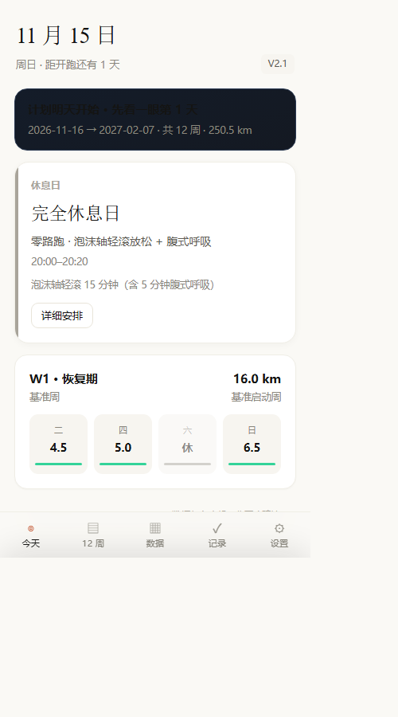
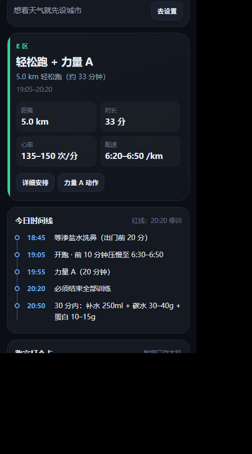
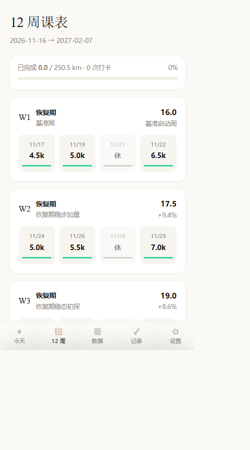
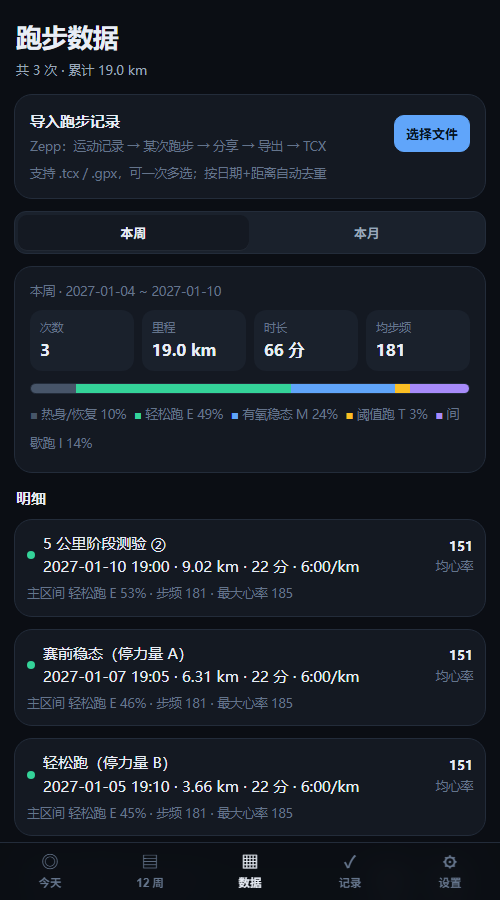
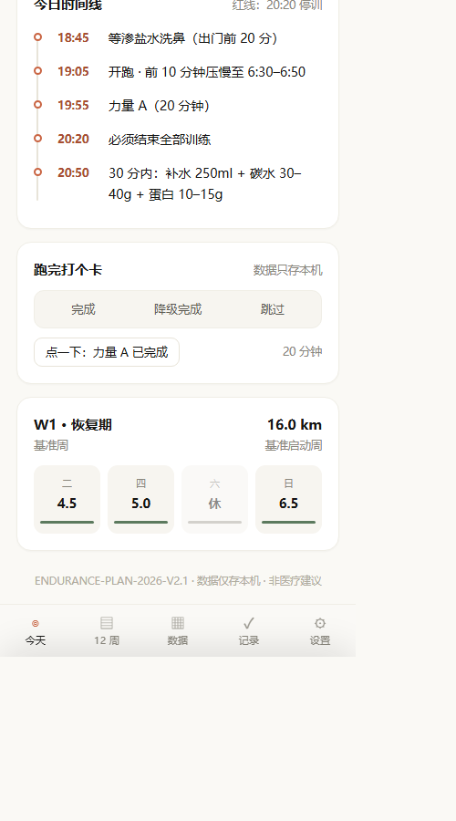

# 12 周跑步 · 今日课表（手机网页应用）

把《12 周跑步恢复与进阶执行手册》《随身口袋手册》《技术评估档案》三份 PDF 变成打开即看的手机界面。

**在线地址**：https://ziren371-art.github.io/sport/

## 更新记录

- **2026-11-15 · 个人资料 + 压力测试**
  - 设置页新增「个人资料」：性别/年龄/身高/体重/静息心率/最大心率/HRV 基线
  - TRIMP 按个人资料计算（性别系数、静息与最大心率），改完可重算历史负荷
  - 压力测试新增 32 项（畸形文件、极端值、边界日期、4 小时长跑、截断 FIT 等），修复心率尖刺污染
  - 明确边界：个人资料**只影响分析，不改变 12 周课表**

- **2026-11-15 · 分析模型升级为「逐课 + 逐组」**
  - 先判课型（轻松跑/长距离/质量课/唤醒跑），不同课型分开统计，不再混算秒数
  - 间歇课自动拆解快跑段与恢复段：组数、单组配速、组间掉速、组间心率回落
  - 强度只对**快跑段**判定（8×400 不再因为整课含大量恢复时间而被误判不达标）
  - 新增训练负荷 TRIMP（按心率储备加权），解决"两次轻松跑 vs 一次间歇"不可比的问题

- **2026-11-15 · 力量训练打卡接入周报**
  - App 打卡卡新增「力量 A/B 已完成」勾选（当天有力量模块时才出现）
  - 打卡数据可导出 JSON，丢进 `跑步数据\导入\` 后周报会把力量完成情况计入达标项
  - 周报新增「打卡记录」表：状态 / 力量 / 体感 / 备注

- **2026-11-15 · 视觉改版 + 周报升级**
  - 界面改为 Claude / Anthropic 风格：暖白纸底（#faf9f5）、墨色字、陶土色（#c96442）点缀、衬线标题
  - 周报/月报新增**逐项达标判定**（达标 X/Y 项 + 未达标项的处理建议）
  - 新增指标：心率漂移、后半程掉速、累计爬升、最快 5K/10K 窗口、周同比
  - 新增 `python scripts/import_runs.py --reparse`：解析器升级后可重算历史数据

- **2026-11-15 · 三格式兼容并接入真实数据**
  - 支持 **TCX / GPX / FIT**（电脑端与手机端一致）
  - 按真实 Zepp 文件修正三处：逐点无 DistanceMeters 时改用 Lap 总距离；步频为单腿值（88）时 ×2；优先用逐点 Speed 算实时配速
  - GPX 没有距离字段，用经纬度估算，**系统性偏大约 5–8%**，报告里标为估算；要精确请导 TCX 或 FIT

- **2026-11-15 · 新增「数据」页签**：导入跑步记录 → 自动算周/月跑量与区间占比。
  - 手机 App 内可导入 TCX/GPX、看本周/本月区间分布、导出 Markdown 给 AI
  - 电脑端有配套脚本，可在 `跑步数据/` 生成周报、月报和 CSV
  - 已注册每周日 21:00 的 Windows 计划任务自动生成
- **2026-11-15 · 跟随 PDF 改版**：力量训练整体重写为"极简 6 动作"。
  - 力量 A（周四，时长 25 → **20 分钟**）：保加利亚分腿蹲 / 微屈膝提踵 / 平板支撑（或死虫式）/ 原地小幅弹性踝跳（可选）
  - 力量 B（周二，**15–20 分钟**）：徒手深蹲 / 双腿臀桥 / 侧卧蚌式开合
  - 新增**跳跃红线**：第 1–4 周严禁任何跳跃动作（含深蹲跳）；第 5–11 周无关节不适才可加低幅度踝跳
  - 其余未变：12 周骨架、250.5 km、配速/心率区间、三个测验日、营养与 HRV 闸门

## 跑步数据：导入 → 周报 → 复盘

跑完在 Zepp 里导出 TCX（运动记录 → 某次跑步 → 分享 → 导出 → **TCX**），有两条落地路径：

**力量训练怎么进报告**：跑完在「今天」页勾一下「力量 A 已完成」→ 设置页「导出 JSON」→ 把导出的文件丢进电脑的 `跑步数据\导入\` → 下次生成周报时自动合并，达标表里就会出现「力量训练 2 次 / 1 次完成」。

**手机端**：打开 App「数据」页签 → 选择文件（.tcx / .gpx / .fit）→ 自动出本周/本月区间分布与逐次明细 → 导出 Markdown。

**电脑端**（生成给 AI 复盘的文件）：
```
跑步数据/
  导入/      ← 把 TCX/GPX 丢这里
  原始/      ← 导入后原文件归档，永不修改
  汇总/runs.csv  weekly.csv  monthly.csv
  周报/W8_2027-01-05.md     ← 复盘底稿（含计划对账与异常提示）
  月报/2027-01.md
```
把文件丢进 `导入/` 后，双击或等周日 21:00 自动执行：
```bat
python scripts\import_runs.py
```
计划任务名：**跑步数据-生成周报**（每周日 21:00，登录状态下运行，错过会在下次可用时补跑）。
运行日志：`汇总/import.log`（每次执行追加一行，失败会记录完整堆栈）。
删除任务：`Unregister-ScheduledTask -TaskName "跑步数据-生成周报"`

**这个脚本对系统的影响**（实测）：单次运行约 0.14 秒、峰值内存约 18 MB、单线程、**不联网**；只读写 `跑步数据` 目录；以当前用户、普通权限（非管理员）运行；不常驻、不注册服务、不写注册表。

## 个人资料与训练计划的关系

设置页的「个人资料」只影响**分析层**：

| 参数 | 影响什么 | 不影响什么 |
|---|---|---|
| 性别 | TRIMP 系数（男 0.64/1.92，女 0.86/1.67） | 课表 |
| 年龄 | 仅用于估算最大心率（Tanaka：208−0.7×年龄） | 课表 |
| 静息 / 最大心率 | TRIMP 的 HRr 归一化 | 课表 |
| 身高 / 体重 | 目前仅作记录（未来可接入能量与 BMI 提示） | 课表 |

**为什么不自动改课表**：12 周课表里的心率区间（E 135–150）和配速档位是 PDF 定的绝对数值，是训练处方的一部分。身体参数一改就让处方漂移，会让"为什么要跑 135–150"失去依据。正确做法是：参数偏离档案基线太多时**提示**你去改 `plan.json`，而不是自动改。

改完个人资料后，电脑端执行 `python scripts\import_runs.py --reparse` 就会用新参数重算全部历史负荷。

## 分析模型（周报/月报怎么算的）

1. **课型判定**：有计划看计划，没计划按配速结构推断 → 轻松跑 / 长距离 / 质量课（间歇·阈值）/ 唤醒跑
2. **结构拆解**：间歇课用两遍阈值识别快跑段（先粗定 85%/25% 速度分位，再用快跑段中位速度细化），排除热身冷身，剔除偏慢离群组
3. **强度判定**：只对快跑段算"配速命中率"（目标区间±3 秒），不再用整课时间占比
4. **负荷**：TRIMP = Σ dt × 0.64 × e^(1.92×HRr)，HRr=(HR−55)/(193−55)
5. **达标项**：周跑量、负荷增幅、质量课配速命中、组间掉速、轻松跑超限时间、长距离里程与后半程掉速、课型完整性、力量打卡

**区间判定口径**（手机端与电脑端完全一致）：
- E 135–150 / M 152–164 / T 166–176 / GP 174–182 / I 178–190，<135 记热身/恢复，>190 记超上限
- 按**逐秒时间占比**统计，不把整次课归到一个区间
- 原文区间有重叠（T 与 GP 在 174–176、GP 与 I 在 178–182）：优先采用当天计划课型，其次比配速，最后按"更具体优先"
- 步频若导出为单腿步频（<120）自动 ×2

## 它解决什么

| 场景 | 以前 | 现在 |
|---|---|---|
| 出门前想知道今天跑什么 | 翻 PDF 找周次 | 打开就一屏：课型、距离、心率、配速、开跑时间 |
| 不知道今天该不该跑 | 靠感觉 | 填 HRV/静息心率 → 绿/黄/红灯，自动建议降级或停跑 |
| 天气要不要改课 | 自己判断 | 取当晚 19:00 温度/降水/空气 → 直接给"改室内力量""压慢前 10 分" |
| 记训练 | 纸质勾选 | 点击打卡 + 体感 + 备注，累计里程对比 250.5 km |

## 怎么用

### 现在就能看（这台电脑）

浏览器打开 `dist/index.html` 即可，无需任何服务。

### 手机上装成 App 图标（推荐，二选一）

**A. Netlify Drop（最快，30 秒，免账号）**
1. 把 `跑步App-发布.zip` 或者 `dist` 文件夹拖进 https://app.netlify.com/drop
2. 拿到 `https://xxx.netlify.app` 网址
3. 手机浏览器打开 → 分享/更多 → “添加到主屏幕”

**B. Cloudflare Pages / GitHub Pages（更稳、可长期）**
- Cloudflare Pages：控制台 → Pages → 上传资源 → 上传 `dist`
- GitHub Pages：新建仓库 → 上传 `dist` 里的文件 → Settings → Pages 选 main 分支根目录

> 国内网络下 `netlify.app`、`pages.dev`、`github.io` 的访问速度差异较大，装好后在手机上实际打开一次确认再决定用哪个。

### 局域网查看（不装任何东西）

在电脑上进入 `dist` 目录，用任意静态服务器开一个端口，手机连同一个 WiFi 访问 `http://电脑IP:端口`。
这种方式只适合临时看，电脑关机即失效。

## 目录

```
跑步App/
  dist/                    ← 部署用（index.html 已内嵌全部数据，可单独打开）
    index.html             86 KB，含 84 天课表
    manifest.webmanifest   添加到主屏幕用
    sw.js                  离线缓存（需 https）
  跑步App-发布.zip          ← 离线分发包（拖去 Netlify 也行）
  src/
    plan.json              ← 课表源数据（改课程改这里）
    app.template.html      ← 界面模板
  scripts/
    gen_plan.py            从 PDF 规格重新生成 plan.json（含跑量硬校验）
    build.py               plan.json + 模板 → dist/index.html
    make_check_table.py    生成校对表.md
    extract_pdf_text.py    从 PDF 抽取文本（PDF 更新后用）
    deploy_github.py       上传 dist 到 GitHub Pages（走 API，不用装 git）
    test.mjs               48 项自动测试（日期/闸门/天气/渲染）
  截图/                     界面截图
  _extract/                 PDF 抽取出来的文本（核对原始依据用）
  校对表.md                 ← 先用它核一遍数字
```

## 改课表 / 加下一周期

1. 打开 `src/plan.json`，`weeks` 是一个数组。加第 13 周就是往数组里加一个对象：
   ```json
   { "n": 13, "start": "2027-02-08", "end": "2027-02-14", "phase": "恢复过渡",
     "label": "赛后恢复周", "km": 16.0, "change": "赛后过渡",
     "days": [ { "date": "2027-02-08", "dow": 0, "dowName": "周一", "type": "rest", ... } ] }
   ```
   每天最少需要 `date / dow / dowName / type / title / main / km / mn / hr / pace / detail`。
2. 在 `跑步App/` 下执行 `python scripts/build.py`，重新生成 `dist/index.html`。
3. 若用 GitHub/Netlify 托管，重新上传 `dist` 即自动更新。

> 只想临时改某一天（例：考试周把周四阈值课改成 E 区）：改 `plan.json` 里那一天的 `title/main/detail` 后重新构建即可，不影响其他天。

## 数据可信度

`scripts/gen_plan.py` 在生成时有硬校验，不通过不会写出文件：

- 12 周 / 84 天
- 四个训练日分列合计：周二 59.0、周四 69.5、周六 15.0、周日 107.0
- 总跑量 250.5 km
- 每周合计与 PDF 一致（含 3 个减量周 −7.9% / −8.7% / −20.4%）

跑量、心率区间、配速档位、力量组数、测验达标线全部来自 PDF 原文；`校对表.md` 供人工复核。

## 已知限制

- 打卡数据存在浏览器 localStorage：**换机或清缓存前请先导出 JSON**（设置 → 导出）。
- 天气来自 Open-Meteo（免 key），空气质量用欧洲 AQI 口径，与国内 AQI 数值不完全等价，仅作"出门不出门"的判断参考。
- 没有云端同步、没有账号：这是刻意的，避免多一个需要维护的东西。
- 训练指导以 PDF 为准；本工具只做提醒和记录，不替代医疗或教练判断。

## 截图（390px 手机宽度实拍）

| 今天（开跑前） | 今天（训练日） | 时间线与打卡 |
|---|---|---|
|  |  |  |

| 12 周课表 | 跑步数据 | 力量打卡 |
|---|---|---|
|  |  |  |

## 验证状态

- ✅ 课表数据：脚本硬校验 250.5 km / 四列合计，48 项自动测试通过
- ✅ 界面：用无头 Chrome 按 390px 宽度实测渲染，检查过 4 个页签与中段滚动
- ⚠️ 天气接口：开发环境无外网，**未能对 Open-Meteo 做真机联网验证**；代码里请求失败会显示"取天气失败"，课表与打卡完全不受影响。第一次在手机上打开时请设好城市并点一次刷新确认。
