# 12 周跑步 · 今日课表（手机网页应用）

把《12 周跑步恢复与进阶执行手册》《随身口袋手册》《技术评估档案》三份 PDF 变成打开即看的手机界面。

**在线地址**：https://ziren371-art.github.io/sport/

## 更新记录

- **2026-11-16 · 第二轮外部审查：7 条全部核实为真，逐条修掉**
  - **P0 早停失效**：`gate` / `pain` 分支写 `S.daily` 用的是课表日期，而 `verdict()` / `gateCard()` 读真实日期 —— 平移过课表后，填的 HRV 存进另一个键，一刷新就"清空"，红黄绿灯形同虚设。改成统一用 `todayISO()`
  - **P0 熔断失效**：`verdict()` 的"未填写 HRV"早返排在按压痛判定**之前**，没戴 HRV 设备的人勾了胫骨按压痛也不会报红灯。把 `m.pain` 提到最前
  - **P0 白屏**：`loadState()` / 导入备份用浅层 `Object.assign`，存储里出现 `"checks":null` 这类损坏值时整页崩且无法自愈。新增 `normalizeState()` 逐字段校验类型
  - **P1 口径冲突**：「今天」页大标题和预览横幅显示的是课表日期，同页其它地方却是用户日期（平移一周后标题会显示 `11 月 9 日`，实际是 `11 月 16 日`）。统一走 `udOf()`
  - **P1 状态矛盾**：只勾「力量已完成」不打跑步卡时，里程算进完成、记录却标「已跳过」。现在只有 `done` / `downgrade` 计入计划里程，其余标「仅力量」
  - **P1 跨档案串味**：`timelineCard()` 与 `weatherAdvice()` 写死了我的热身配速 `6:30–6:50`，朋友（E 区 8:45–9:20）收到的是接近间歇配速的建议。改成按各自课表的 E 上限给心率提示
  - **P2 文案方向错**：`saveStart` 对周三/周五也弹"是训练日，已顺延"，实际是**向前**对齐到本周一。现在按方向分两种提示
  - 顺带 `curDate()` 改名 `planToday()`：让"这个日期属于哪个空间"写在名字上，从命名上堵住上面第 1 类错误
  - **第三轮补充**：`verdict()` 的「未填写」拦截仍排在静息心率判定之前 —— 不戴 HRV 手表、只量了静息心率（如 76）的人会看到「未填写」而不是红灯。改成两项都空才算未填写，单填哪项都能判灯
  - 测试 142 → **172 项**

- **2026-11-16 · 加「我的第 1 天」+ 红黄绿灯改成按个人基线算**
  - 「我的第 1 天」：整份课表按**整周**平移，星期几不变。选到周一直接用；选到训练日（周二/四/日）自动顺延到下一个周一，避免一上手就被推上质量课；选到周三/周五（休息日）用当周周一，等于"今天休息，下一个训练日正常开跑"
  - 打卡一律按**课表日期**存，所以改「我的第 1 天」不会让已有记录错位
  - 红黄绿灯不再写死 58/60/65：改成相对个人静息基线 **+3 绿灯 / +5 黄灯 / +10 红灯**。我的基线 55 行为不变；朋友基线 66 才是 69/71/76 —— 写死的话他每天都会判红灯
  - 黄灯里的「降级到 E 区（≤148）」也改成读各自课表的 E 上限（朋友是 ≤146）
  - 每个档案自带**默认身体数据**（我 167/50/55，朋友 172/84/66），不再互相串用示例值
  - 兼容迁移：旧的 `runkit.v1` → `runkit.v2.me`，朋友那份独立文件的 `runkit.friend.v1` → `runkit.v2.friend`
  - 测试 118 → **142 项**

- **2026-11-16 · 双档案：朋友的课表进来了，记录各存各的**
  - 应用从"一份课表"变成"课表库"：内置**我的 12 周（250.5 km）**和**朋友的 12 周无伤耐力与步频进阶（183.0 km）**
  - 首次打开先选档案；之后可在「设置 → 档案」切换，`?plan=friend` 可直接进朋友那份
  - 记录按档案分开存（`runkit.v2.me` / `runkit.v2.friend`），切换互不覆盖；导出会标明属于哪个档案，导错档案会先问
  - 老版本的单课表数据 `runkit.v1` 首次启动自动迁移到 me 档案
  - **顺带修掉三个"写死"**：心率区间（135–150 那套）改成从各自课表的 zones 表解析——朋友是 E 132–146，写死就会误判；阶段配速改成按课表自身配速推中位数；总跑量 250.5 改成读 `meta.totalKm`
  - 新脚本：`check_plan.py`（课表自洽校验）、`extract_embedded_plan.py`（从单文件 HTML 里抠出课表）
  - 测试 90 → **118 项**，其中一个当场抓出真 bug：`Object.assign({}, DEF)` 是浅拷贝，两个档案会共享同一个 `checks` 对象

- **2026-11-16 · 休息日不再打卡 + 数据存不住能看见 + 真的能装成 App**
  - 休息日（84 天里占 42 天）不再显示「完成 / 降级完成 / 跳过」。休息本身是训练内容，给三个按钮等于暗示"可以不休息"。想看计划外活动时留了一个低调的「记一笔」，只进记录、不占计划里程
  - 城市不用再手输：首次打开按系统时区自动推断（Asia/Shanghai → 上海），并自动取天气；另加「用当前位置」一键定位
  - 存储不再静默失败：启动即探测 localStorage，被禁时顶部常驻红条说明原因并给「导出备份 / 怎么修 / 环境自检」，设置页新增「环境自检」四格（打开方式 / 能存数据 / 已装到桌面 / 定位可用）
  - **修掉一个死代码 bug**：`manifest.webmanifest` 与 `sw.js` 早就生成了，但模板从来没引用过——PWA 一直是摆设，装不上。现已接上 manifest、apple-touch-icon 与 Service Worker 注册
  - 新增首次使用引导（三件事）与「装成手机 App」说明；测试从 48 项扩到 85 项

- **2026-11-15 · 修复外部代码审查发现的 5 个问题**
  - P0 开跑前一日提示卡残留深色内联样式，导致浅色主题下黑底黑字（另修了预览横幅同类残留）
  - P0 三处引用未定义的旧变量 `--tx/--tx2/--tx3`（改为 `--ink/--ink2/--ink3`），其中"跳过"标签因此错显绿色
  - P1 W8 测验卡年份写成 2026，应为 2027-01-10
  - P1 `?tab=data` 被初始化白名单挡住，无法直达数据页
  - P1 W4 周四定速复测被标成"T 区"，改为"动态复测配速"（5:40 不属于 T 区 5:25–5:35）

- **2026-11-15 · 个人资料 + 压力测试**
  - 设置页新增「个人资料」：性别/年龄/身高/体重/静息心率/最大心率/HRV 基线
  - TRIMP 按个人资料计算（性别系数、静息与最大心率），改完可重算历史负荷
  - 压力测试新增 32 项（畸形文件、极端值、边界日期、4 小时长跑、截断 FIT 等），修复心率尖刺污染
  - 明确边界：个人资料**只影响分析，不改变 12 周课表**

- **2026-11-15 · 分析模型升级为「逐课 + 逐组」**
  - 先判课型（轻松跑/长距离/质量课/唤醒跑），不同课型分开统计，不再混算秒数
  - 间歇课自动拆解快跑段与恢复段：组数、单组配速、组间掉速、组间心率回落
  - 强度只对**快跑段**判定（8×400 不再因为整课含大量恢复时间而被误判不达标）
  - 新增训练负荷 TRIMP（按心率储备加权），解决"两次轻松跑 vs 一次间歇"不可比的问题

- **2026-11-15 · 力量训练打卡接入周报**
  - App 打卡卡新增「力量 A/B 已完成」勾选（当天有力量模块时才出现）
  - 打卡数据可导出 JSON，丢进 `跑步数据\导入\` 后周报会把力量完成情况计入达标项
  - 周报新增「打卡记录」表：状态 / 力量 / 体感 / 备注

- **2026-11-15 · 视觉改版 + 周报升级**
  - 界面改为 Claude / Anthropic 风格：暖白纸底（#faf9f5）、墨色字、陶土色（#c96442）点缀、衬线标题
  - 周报/月报新增**逐项达标判定**（达标 X/Y 项 + 未达标项的处理建议）
  - 新增指标：心率漂移、后半程掉速、累计爬升、最快 5K/10K 窗口、周同比
  - 新增 `python scripts/import_runs.py --reparse`：解析器升级后可重算历史数据

- **2026-11-15 · 三格式兼容并接入真实数据**
  - 支持 **TCX / GPX / FIT**（电脑端与手机端一致）
  - 按真实 Zepp 文件修正三处：逐点无 DistanceMeters 时改用 Lap 总距离；步频为单腿值（88）时 ×2；优先用逐点 Speed 算实时配速
  - GPX 没有距离字段，用经纬度估算，**系统性偏大约 5–8%**，报告里标为估算；要精确请导 TCX 或 FIT

- **2026-11-15 · 新增「数据」页签**：导入跑步记录 → 自动算周/月跑量与区间占比。
  - 手机 App 内可导入 TCX/GPX、看本周/本月区间分布、导出 Markdown 给 AI
  - 电脑端有配套脚本，可在 `跑步数据/` 生成周报、月报和 CSV
  - 已注册每周日 21:00 的 Windows 计划任务自动生成
- **2026-11-15 · 跟随 PDF 改版**：力量训练整体重写为"极简 6 动作"。
  - 力量 A（周四，时长 25 → **20 分钟**）：保加利亚分腿蹲 / 微屈膝提踵 / 平板支撑（或死虫式）/ 原地小幅弹性踝跳（可选）
  - 力量 B（周二，**15–20 分钟**）：徒手深蹲 / 双腿臀桥 / 侧卧蚌式开合
  - 新增**跳跃红线**：第 1–4 周严禁任何跳跃动作（含深蹲跳）；第 5–11 周无关节不适才可加低幅度踝跳
  - 其余未变：12 周骨架、250.5 km、配速/心率区间、三个测验日、营养与 HRV 闸门

## 跑步数据：导入 → 周报 → 复盘

跑完在 Zepp 里导出 TCX（运动记录 → 某次跑步 → 分享 → 导出 → **TCX**），有两条落地路径：

**力量训练怎么进报告**：跑完在「今天」页勾一下「力量 A 已完成」→ 设置页「导出 JSON」→ 把导出的文件丢进电脑的 `跑步数据\导入\` → 下次生成周报时自动合并，达标表里就会出现「力量训练 2 次 / 1 次完成」。

**手机端**：打开 App「数据」页签 → 选择文件（.tcx / .gpx / .fit）→ 自动出本周/本月区间分布与逐次明细 → 导出 Markdown。

**电脑端**（生成给 AI 复盘的文件）：
```
跑步数据/
  导入/      ← 把 TCX/GPX 丢这里
  原始/      ← 导入后原文件归档，永不修改
  汇总/runs.csv  weekly.csv  monthly.csv
  周报/W8_2027-01-05.md     ← 复盘底稿（含计划对账与异常提示）
  月报/2027-01.md
```
把文件丢进 `导入/` 后，双击或等周日 21:00 自动执行：
```bat
python scripts\import_runs.py
```
计划任务名：**跑步数据-生成周报**（每周日 21:00，登录状态下运行，错过会在下次可用时补跑）。
运行日志：`汇总/import.log`（每次执行追加一行，失败会记录完整堆栈）。
删除任务：`Unregister-ScheduledTask -TaskName "跑步数据-生成周报"`

**这个脚本对系统的影响**（实测）：单次运行约 0.14 秒、峰值内存约 18 MB、单线程、**不联网**；只读写 `跑步数据` 目录；以当前用户、普通权限（非管理员）运行；不常驻、不注册服务、不写注册表。

## 个人资料与训练计划的关系

设置页的「个人资料」只影响**分析层**：

| 参数 | 影响什么 | 不影响什么 |
|---|---|---|
| 性别 | TRIMP 系数（男 0.64/1.92，女 0.86/1.67） | 课表 |
| 年龄 | 仅用于估算最大心率（Tanaka：208−0.7×年龄） | 课表 |
| 静息 / 最大心率 | TRIMP 的 HRr 归一化 | 课表 |
| 身高 / 体重 | 目前仅作记录（未来可接入能量与 BMI 提示） | 课表 |

**为什么不自动改课表**：12 周课表里的心率区间（E 135–150）和配速档位是 PDF 定的绝对数值，是训练处方的一部分。身体参数一改就让处方漂移，会让"为什么要跑 135–150"失去依据。正确做法是：参数偏离档案基线太多时**提示**你去改 `plan.json`，而不是自动改。

改完个人资料后，电脑端执行 `python scripts\import_runs.py --reparse` 就会用新参数重算全部历史负荷。

## 分析模型（周报/月报怎么算的）

1. **课型判定**：有计划看计划，没计划按配速结构推断 → 轻松跑 / 长距离 / 质量课（间歇·阈值）/ 唤醒跑
2. **结构拆解**：间歇课用两遍阈值识别快跑段（先粗定 85%/25% 速度分位，再用快跑段中位速度细化），排除热身冷身，剔除偏慢离群组
3. **强度判定**：只对快跑段算"配速命中率"（目标区间±3 秒），不再用整课时间占比
4. **负荷**：TRIMP = Σ dt × 0.64 × e^(1.92×HRr)，HRr=(HR−55)/(193−55)
5. **达标项**：周跑量、负荷增幅、质量课配速命中、组间掉速、轻松跑超限时间、长距离里程与后半程掉速、课型完整性、力量打卡

**区间判定口径**（手机端与电脑端完全一致）：
- E 135–150 / M 152–164 / T 166–176 / GP 174–182 / I 178–190，<135 记热身/恢复，>190 记超上限
- 按**逐秒时间占比**统计，不把整次课归到一个区间
- 原文区间有重叠（T 与 GP 在 174–176、GP 与 I 在 178–182）：优先采用当天计划课型，其次比配速，最后按"更具体优先"
- 步频若导出为单腿步频（<120）自动 ×2

## 它解决什么

| 场景 | 以前 | 现在 |
|---|---|---|
| 出门前想知道今天跑什么 | 翻 PDF 找周次 | 打开就一屏：课型、距离、心率、配速、开跑时间 |
| 不知道今天该不该跑 | 靠感觉 | 填 HRV/静息心率 → 绿/黄/红灯，自动建议降级或停跑 |
| 天气要不要改课 | 自己判断 | 取当晚 19:00 温度/降水/空气 → 直接给"改室内力量""压慢前 10 分" |
| 记训练 | 纸质勾选 | 点击打卡 + 体感 + 备注，累计里程对比 250.5 km |

## 怎么用

### 现在就能看（这台电脑）

浏览器打开 `dist/index.html` 即可，无需任何服务。

### 手机上装成 App 图标（PWA，不需要服务器）

在线地址：https://ziren371-art.github.io/sport/

- **iPhone**：Safari 打开网址 → 分享 → 添加到主屏幕
- **安卓**：Chrome 打开网址 → 右上角 ⋮ → 安装应用（或添加到主屏幕）

装好后是独立图标 + 全屏窗口（`display: standalone`），Service Worker 缓存了页面壳，断网也能看课表。
装成功没有可以确认：设置页 →「环境自检」→「已装到桌面」会从「否」变「是」。

> **别把双击本地 `index.html` 当日常用法。** 手机上用 file:// 打开本地文件，多数浏览器不给存储权限，
> 填过的 HRV、打卡、城市会随刷新清空。临时看一眼可以，日常请用上面这个网址。

### 换托管（可选）

- Netlify Drop：把 `dist` 文件夹拖进 https://app.netlify.com/drop ，免账号
- Cloudflare Pages：控制台 → Pages → 上传资源 → 上传 `dist`
- GitHub Pages：`python scripts/deploy_github.py --repo <owner/name> --token <PAT>`

> `netlify.app`、`pages.dev`、`github.io` 在国内的访问速度差异较大，装好后在手机上实际打开确认再定。

### 局域网查看（不装任何东西）

在电脑上进入 `dist` 目录，用任意静态服务器开一个端口，手机连同一个 WiFi 访问 `http://电脑IP:端口`。
这种方式只适合临时看，电脑关机即失效。

## 给朋友用：要不要服务器？

结论：**现在不需要服务器**。这是个单文件静态页面，托管用的 GitHub Pages 本身就是"免费静态服务器"；
每个人的数据存在**他自己手机的浏览器**里，天然互不干扰。朋友只要打开同一个网址、加到主屏幕就行。

真需要后端（账号 / 数据库）的只有这几种情况：

| 想要的效果 | 需要服务器吗 | 现在怎么凑 |
|---|---|---|
| 朋友也能用同一份课表 | 不需要 | 把网址发他，加到主屏幕 |
| 各自记录互不干扰 | 不需要（本来就互不干扰） | 数据在各自浏览器 localStorage 里 |
| 换手机 / 清缓存后数据还在 | 不需要（手动即可） | 设置 → 导出备份 → 新机导入 |
| 两个人互看进度、排行榜 | **需要** | 暂无 |
| 我改了课表，朋友那边自动更新 | 不需要 | 重新部署 GitHub Pages 即可 |
| 变成商店里的 .apk / .ipa | 需要（且要开发者账号） | PWA 已经够用，不必上架 |

**"给朋友用"现在是什么状态**：应用里已经有朋友那份课表（183.0 km）。把网址发他、让他选
「12 周无伤耐力与步频进阶」那个档案，或者直接发 `?plan=friend` 链接，他的记录就存在他自己手机的
`runkit.v2.friend` 里，和你的完全不交叉。

**开始日期已经可调**：设置里有「我的第 1 天」。整份课表按**整周**平移（星期几不变），
所以朋友哪天开始都行——选到训练日会自动顺延到下一个周一，不会一上手就被推上质量课。
打卡按课表日期存，所以事后改开始日期也不会让已有记录错位。仍然不需要服务器。

万一将来真要上后端（账号 + 云同步 + 排行榜），最小方案是 Cloudflare Workers + D1，或 Supabase 免费档；
代码里已经把存储抽成一个 `Store` 对象（`read` / `write` / `drop`），换成远端读写就行，页面逻辑不用动。

## 目录

```
跑步App/
  dist/                    ← 部署用（index.html 已内嵌全部数据，可单独打开）
    index.html             124 KB，含 84 天课表
    manifest.webmanifest   装到桌面用（已被 <head> 引用）
    sw.js                  离线缓存 + 更新策略（需 http/https 才注册）
    icon.svg / icon-180.png / icon-192.png / icon-512.png / icon-maskable-512.png
  跑步App-发布.zip          ← 离线分发包（拖去 Netlify 也行）
  src/
    plan.json              ← 我的课表（改课程改这里）
    plan-friend.json       ← 朋友的课表（183.0 km，结构同构）
    app.template.html      ← 界面模板
  scripts/
    gen_plan.py            从 PDF 规格重新生成 plan.json（含跑量硬校验）
    build.py               plan.json + plan-friend.json + 模板 → dist/index.html
    check_plan.py          课表自洽校验（结构 / 日期连续 / 周合计 / 引用完整）
    extract_embedded_plan.py  从单文件课表 HTML 里抠出 PLAN 数据
    make_icons.py          生成 PWA 图标（改主题色时重跑）
    make_check_table.py    生成校对表.md
    extract_pdf_text.py    从 PDF 抽取文本（PDF 更新后用）
    deploy_github.py       上传 dist 到 GitHub Pages（走 API，不用装 git）
    split_source.py        把源码切成可粘贴的分片 → 源码分段/
    join_source.py         把分片拼回原文件（并校验一致）
    runs_lib.py            TCX/GPX/FIT 解析与区间判定
    import_runs.py         导入跑步记录 → 周报 / 月报 / 达标判定
    test_runs.py / test_formats.py / test_interval.py / stress_test.py
    test.mjs               172 项自动测试（日期/闸门/天气/渲染/休息日/存储降级/PWA/双档案/平移/按基线判灯/损坏存储）
  源码分段/                  源码的分片文本（给收不了文件、只能收粘贴的工具用）
  _reference/               朋友课表原始 HTML（Argon 生成的那份，数据已抽取进 src）
  截图/                     界面截图
  _extract/                 PDF 抽取出来的文本（核对原始依据用）
  校对表.md                 ← 先用它核一遍数字
```

## 改课表 / 加下一周期

1. 打开 `src/plan.json`，`weeks` 是一个数组。加第 13 周就是往数组里加一个对象：
   ```json
   { "n": 13, "start": "2027-02-08", "end": "2027-02-14", "phase": "恢复过渡",
     "label": "赛后恢复周", "km": 16.0, "change": "赛后过渡",
     "days": [ { "date": "2027-02-08", "dow": 0, "dowName": "周一", "type": "rest", ... } ] }
   ```
   每天最少需要 `date / dow / dowName / type / title / main / km / mn / hr / pace / detail`。
2. 在 `跑步App/` 下执行 `python scripts/build.py`，重新生成 `dist/index.html`。
3. 若用 GitHub/Netlify 托管，重新上传 `dist` 即自动更新。

> 只想临时改某一天（例：考试周把周四阈值课改成 E 区）：改 `plan.json` 里那一天的 `title/main/detail` 后重新构建即可，不影响其他天。

## 数据可信度

`scripts/gen_plan.py` 在生成时有硬校验，不通过不会写出文件：

- 12 周 / 84 天
- 四个训练日分列合计：周二 59.0、周四 69.5、周六 15.0、周日 107.0
- 总跑量 250.5 km
- 每周合计与 PDF 一致（含 3 个减量周 −7.9% / −8.7% / −20.4%）

跑量、心率区间、配速档位、力量组数、测验达标线全部来自 PDF 原文；`校对表.md` 供人工复核。

## 已知限制

- 打卡数据存在浏览器 localStorage：**换机或清缓存前请先导出 JSON**（设置 → 导出）。
- localStorage 在某些打开方式下会被禁用（本地 file:// 文件、微信/QQ 内置浏览器、无痕模式），此时数据存不住。
  v2.2 起启动就探测并顶部红条提示，不再静默丢数据；设置页「环境自检」能直接看出是哪一项不满足。
- 课表日期是写死的 12 周（2026-11-16 → 2027-02-07），换周期或给别人用需要平移，见上一节。
- 天气来自 Open-Meteo（免 key），空气质量用欧洲 AQI 口径，与国内 AQI 数值不完全等价，仅作"出门不出门"的判断参考。
- 没有云端同步、没有账号：这是刻意的，避免多一个需要维护的东西。
- 训练指导以 PDF 为准；本工具只做提醒和记录，不替代医疗或教练判断。

## 截图（500px 宽度，无头 Chrome 实拍）

| 今天 · 休息日（无打卡） | 今天 · 训练日 | 首次引导 |
|---|---|---|
| 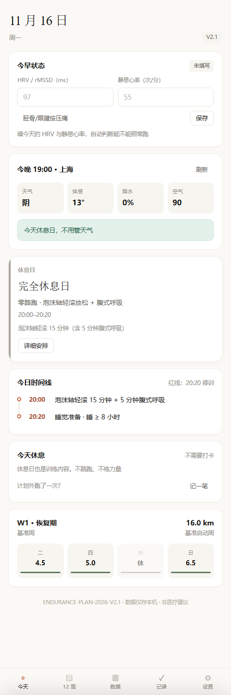 | 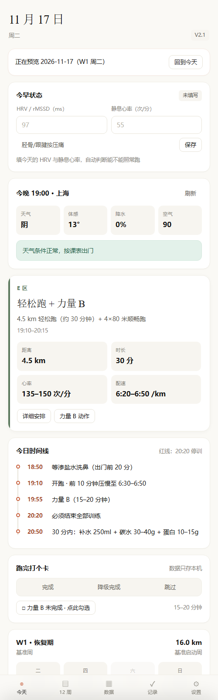 | 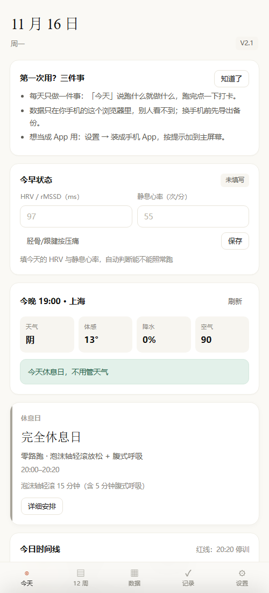 |

| 12 周课表 | 记录 | 数据页 |
|---|---|---|
| 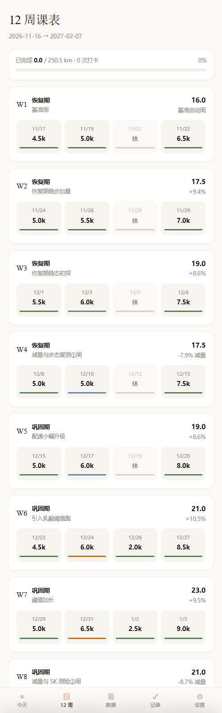 | 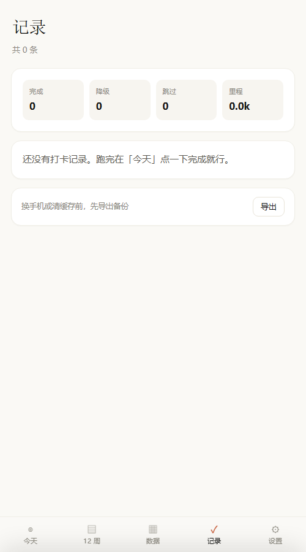 | 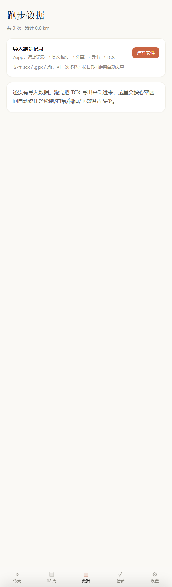 |

| 设置（含环境自检） | 力量卡 | 当天详细安排 |
|---|---|---|
|  | 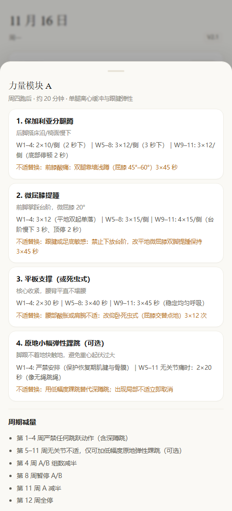 | 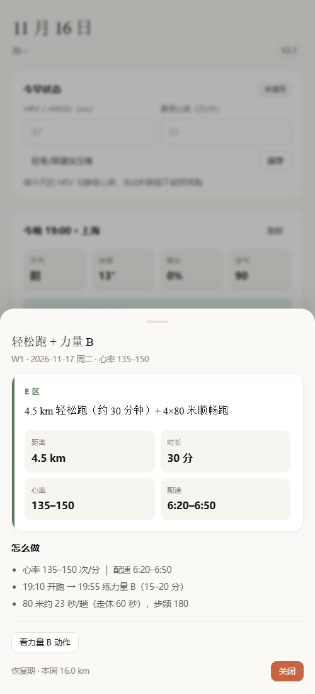 |

| 选择档案 | 朋友的课表（183 km） | 测验卡 |
|---|---|---|
| 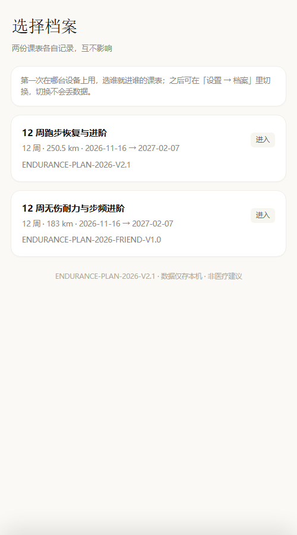 | 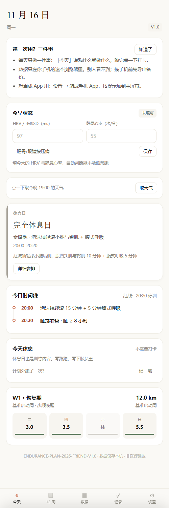 | 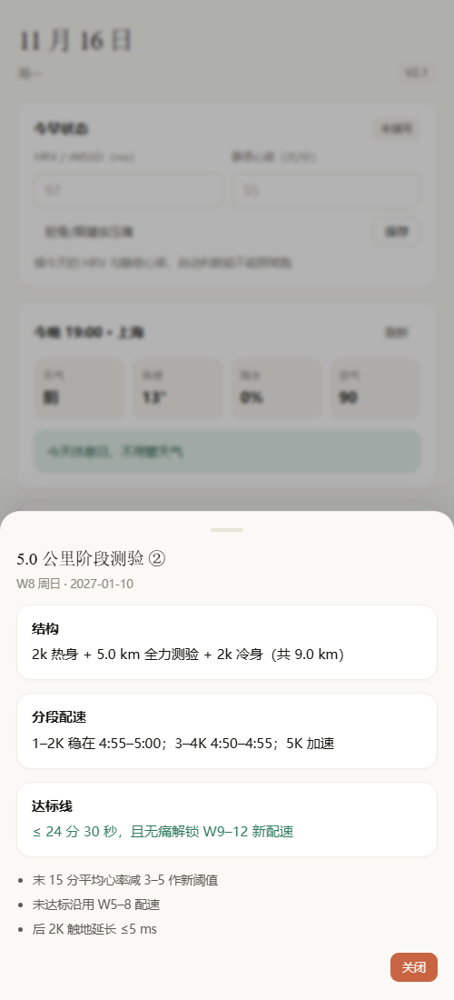 |

| 「我的第 1 天」整周平移后 | | |
|---|---|---|
| 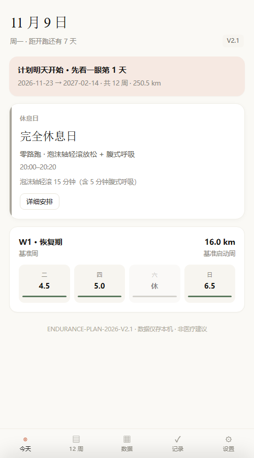 | | |

> 为什么是 500px 而不是 390px：Windows 上的无头 Chrome 有窗口最小宽度（约 490px），
> 传 `--window-size=390` 会被静默夹到 493，截出来的图右侧被裁掉。用 500px 才能看到完整版式。

## 验证状态

- ✅ 课表数据：`check_plan.py` 校验两份课表结构与数字自洽（我 250.5 km / 朋友 183.0 km）
- ✅ 自动测试：`test.mjs` **172 项**（含休息日不打卡、存储降级、PWA 引用完整性）+ Python 侧 `test_runs` / `test_formats` / `test_interval` / `stress_test`（32 项）全部通过
- ✅ 界面：无头 Chrome 实拍 13 个界面状态，检查过 5 个页签与中段滚动
- ⚠️ 天气接口：开发环境无外网，**未能对 Open-Meteo 做真机联网验证**；代码里请求失败会显示"取天气失败"，课表与打卡完全不受影响。第一次在手机上打开时请确认城市（会自动推断）并点一次刷新。
- ⚠️ PWA 安装：只能在真实 https 环境验收（本地 file:// 不注册 Service Worker）。装好后用设置页「环境自检 → 已装到桌面」确认。
